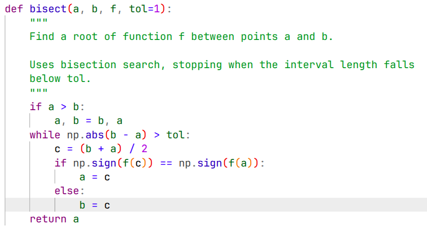

# Vakio palette

<p align="center">

<br>
<sub>Python syntax highlighting in VS Code with rainbow brackets</sub>
</p>

Vakio is a light-background syntax color palette that:

* is parametrized in the 
[Oklch color space](https://en.wikipedia.org/wiki/Oklab_color_space) 
using two lightness levels at which chroma is maximized, 
see [Palette design](design.ipynb)

* can be injected into 
[Catppuccin](https://catppuccin.com/) templates, 
see [Usage](usage.ipynb)

* provides reasonable approximations of many widely used colors, see [Comparison](comparison.ipynb)

## Ports

`ports/` contains m4 templates of themes for kitty, micro, fish, fzf
and bat. The ports for micro, fish, fzf and bat are adapted from
Catppuccin Latte, and use its colour names, e.g. `latte_blue`. Build
the themes with

```
ports/build.sh OUTDIR
```

which writes a directory for each program: `kitty/vakio.conf`,
`micro/vakio.micro`, `fish/vakio.theme`, `fzf/vakio.fish` and
`bat/vakio.tmTheme`. On each push to `main`, a GitHub workflow builds
the themes and publishes them as `themes.tar.gz` in the release with
the tag `themes`:
https://github.com/l-oksanen/vakio/releases/download/themes/themes.tar.gz
